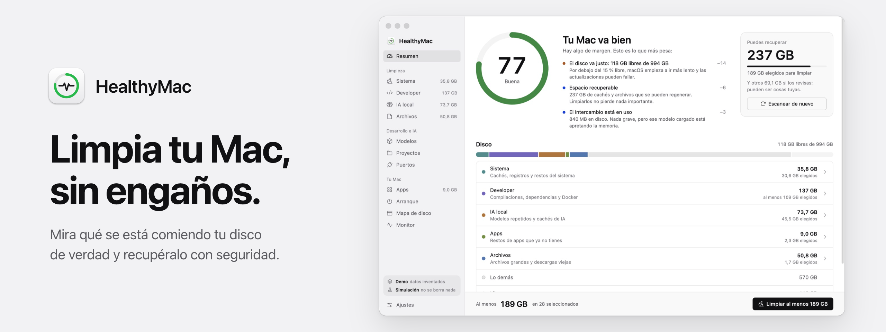
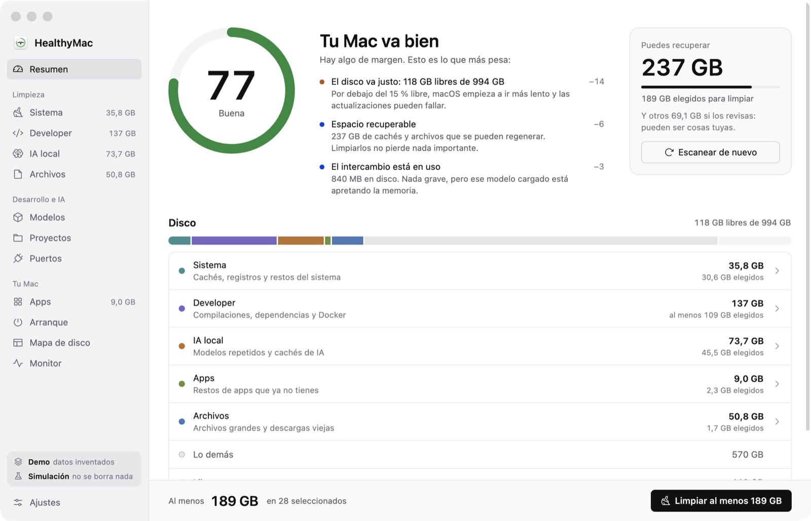
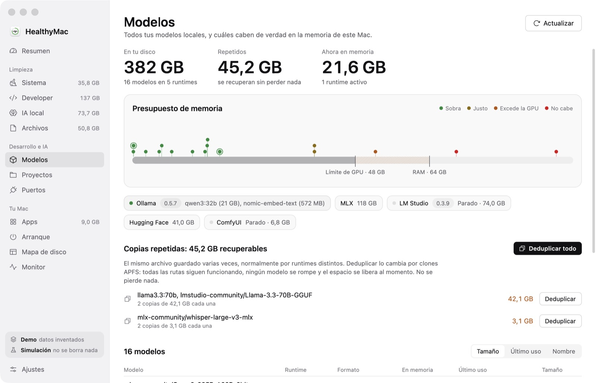
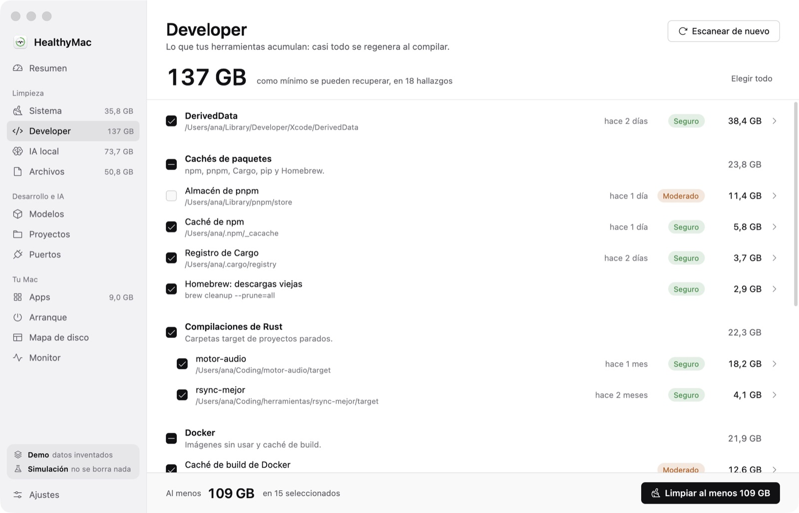
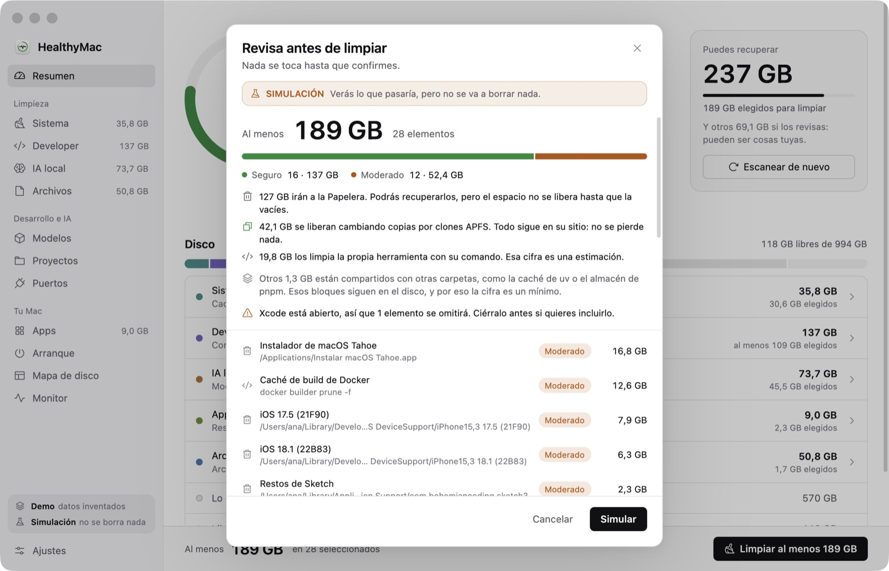
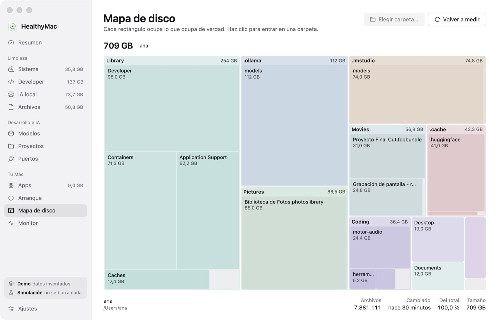
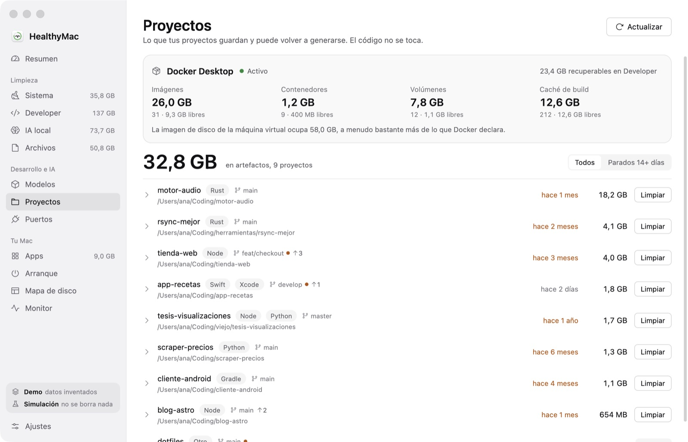
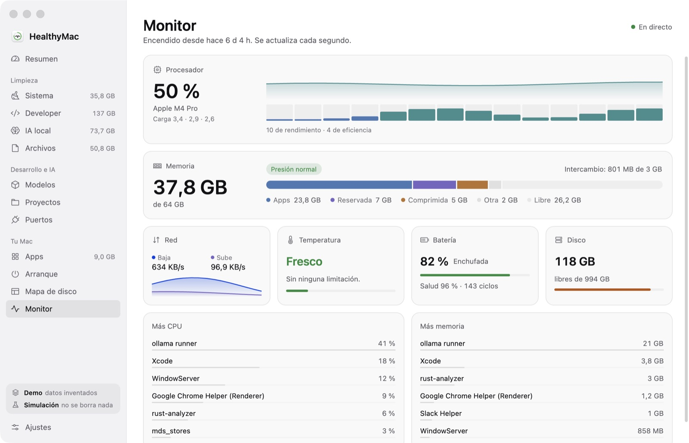

<p align="right"><a href="README.md">English</a> · <b>Español</b></p>

<p align="center">
  
</p>

<p align="center">
  <b>Mira qué se está comiendo tu disco de verdad y recupéralo con seguridad.<br>
  HealthyMac sabe cuánto liberan en realidad los clones de APFS, entiende tus carpetas de compilación y tus modelos de IA local,<br>
  y lo manda todo primero a la Papelera. Una alternativa libre y gratuita a CleanMyMac, escrita en Rust.</b>
</p>

<p align="center">
  
  
  
  
  
  
  <br>
  
  
  
  <a href="LICENSE"></a>
</p>

<p align="center">
  <a href="#%EF%B8%8F-instalar"><b>⬇️ Instalar</b></a> ·
  <a href="https://github.com/fernandevdaza/HealthyMac/releases"><b>📦 Versiones</b></a> ·
  <a href="#%EF%B8%8F-seguridad"><b>🛡️ Seguridad</b></a> ·
  <a href="docs/ARCHITECTURE.md"><b>📖 Arquitectura</b></a> ·
  <a href="#%EF%B8%8F-desarrollo"><b>🛠️ Desarrollo</b></a>
</p>

<div align="center">

| **Tamaños reales** | **14 runtimes de IA** | **Primero a la Papelera** | **672 tests** | **12 MB** |
|:---:|:---:|:---:|:---:|:---:|
| cuenta los clones APFS y los enlaces duros | un solo inventario, comparado con el límite de memoria de Metal | cada ruta se revalida justo antes de actuar | seguridad, escáneres y analizadores | ~1 % de CPU y ~100 MB de RAM en reposo |

</div>

> **Nada sale de tu Mac.** Sin cuenta, sin suscripción y sin telemetría. Solo se conecta a los runtimes de IA en
> `127.0.0.1`, para ver qué tienen cargado.

> [!WARNING]
> **Es una versión temprana, y borra cosas.** Las limpiezas reales solo se han hecho en un Mac (M5 Pro, macOS 27). Mira
> [qué se ha probado](#-verificación) y empieza con una [simulación](#-primeros-pasos).

---

## ✨ Funciones

- **Tamaños de fiar.** pnpm, uv y bun construyen sus carpetas con clones APFS de un almacén global, así que un `.venv`
  de 961 MB puede liberar solo 45 MB. HealthyMac le pregunta a APFS qué bloques son exclusivos y separa lo que se
  liberaría de lo que seguiría en disco de todas formas.
- **IA local de primera clase.** Un único inventario para LM Studio, Ollama, Hugging Face, MLX, oMLX, Whisper, llama.cpp,
  Jan, GPT4All, ComfyUI, Automatic1111, Draw Things, Torch Hub y Sentence Transformers: metadatos GGUF, qué cabe en tu
  memoria unificada según el límite real de Metal, descargas abandonadas y qué runtimes están en marcha.
- **Deduplica sin perder nada.** Si dos runtimes guardan los mismos pesos, los convierte en clones APFS. Cada programa
  sigue encontrando su archivo y solo se liberan los bloques repetidos.
- **Pensado para developers.** Xcode (DerivedData, soporte de dispositivos, simuladores), artefactos en cualquier
  proyecto (`target`, `node_modules`, `.venv`, `.terraform`…), cachés de paquetes (npm, pnpm, Yarn, Bun, Cargo, Go,
  Gradle, Maven, pip, uv, Poetry, Homebrew, CocoaPods…), Docker, toolchains y cachés de IDE. Los proyectos activos se
  listan, pero nunca se preseleccionan.
- **Proyectos y puertos.** Tus proyectos con su actividad, artefactos y estado de git, y qué proceso escucha en cada
  puerto, junto con el proyecto al que pertenece.
- **También limpia el sistema.** Cachés, registros, restos de apps desinstaladas, archivos grandes, duplicados,
  instaladores viejos, copias de iOS e instantáneas de Time Machine.
- **Una puntuación de salud que se explica.** Cada punto que resta viene con su motivo.
- **Mapa de disco y monitor.** Un treemap navegable, además de CPU, memoria, red, temperatura, batería y procesos.
- **Apps y arranque.** Tamaño, restos y arquitectura de cada app, un desinstalador, y los elementos de arranque con los
  huérfanos marcados.
- **Se ve como una app de Mac.** Grises neutros y SF Pro; el color aparece solo cuando dice algo, como un nivel de
  riesgo, la presión de memoria o una serie en un gráfico. Claro u oscuro, español o inglés: sigue a macOS (si no está
  en español, se muestra en inglés), o lo eliges en Ajustes.
- **Línea de comandos.** `healthymac scan --json` y compañía, para tus scripts.

## 📸 Capturas

<sub>Modo demo: todos los datos son inventados. Las imágenes siguen el tema de GitHub, claro u oscuro.</sub>

<table>
  <tr>
    <td colspan="2"><picture><source media="(prefers-color-scheme: dark)" srcset="docs/screenshots/overview-es-dark.jpg"></picture><p align="center"><sub><b>Resumen</b> · puntuación de salud con sus motivos, uso del disco por área y lo que puedes recuperar</sub></p></td>
  </tr>
  <tr>
    <td width="50%"><picture><source media="(prefers-color-scheme: dark)" srcset="docs/screenshots/models-es-dark.jpg"></picture><p align="center"><sub><b>Modelos</b> · presupuesto de memoria, runtimes en marcha y copias repetidas</sub></p></td>
    <td width="50%"><picture><source media="(prefers-color-scheme: dark)" srcset="docs/screenshots/developer-es-dark.jpg"></picture><p align="center"><sub><b>Developer</b> · Xcode, cachés de paquetes y compilaciones de proyectos parados</sub></p></td>
  </tr>
  <tr>
    <td><picture><source media="(prefers-color-scheme: dark)" srcset="docs/screenshots/review-es-dark.jpg"></picture><p align="center"><sub><b>Revisión</b> · qué va a la Papelera, qué se libera ahora y qué se queda</sub></p></td>
    <td><picture><source media="(prefers-color-scheme: dark)" srcset="docs/screenshots/disk-map-es-dark.jpg"></picture><p align="center"><sub><b>Mapa de disco</b> · haz clic en una carpeta para entrar</sub></p></td>
  </tr>
  <tr>
    <td><picture><source media="(prefers-color-scheme: dark)" srcset="docs/screenshots/projects-es-dark.jpg"></picture><p align="center"><sub><b>Proyectos</b> · actividad, artefactos, estado de git y Docker</sub></p></td>
    <td><picture><source media="(prefers-color-scheme: dark)" srcset="docs/screenshots/monitor-es-dark.jpg"></picture><p align="center"><sub><b>Monitor</b> · CPU, memoria, red, temperatura y batería en directo</sub></p></td>
  </tr>
</table>

## ⬇️ Instalar

Necesitas un Mac con Apple Silicon. En Terminal:

```bash
curl -fsSL https://raw.githubusercontent.com/fernandevdaza/HealthyMac/main/scripts/install.sh | sh
```

Eso instala la última versión en `/Applications`. ¿Lo prefieres a mano? Descarga `HealthyMac-mac-arm64.dmg` desde
**[Versiones](https://github.com/fernandevdaza/HealthyMac/releases)** y arrastra la app a Aplicaciones.

> [!NOTE]
> HealthyMac tiene firma ad hoc, no está notarizada: para eso hace falta un Apple Developer ID de pago. macOS bloquea una
> app así cuando se ha descargado con el navegador. Para abrirla, ejecuta `xattr -cr /Applications/HealthyMac.app` o
> permítela en *Ajustes del Sistema → Privacidad y seguridad*. La instalación por Terminal no necesita esto.

## 🚀 Primeros pasos

1. Pruébala con datos inventados, donde nada puede llegar al limpiador real:

   ```bash
   open --env HEALTHYMAC_DEMO=1 /Applications/HealthyMac.app
   ```

2. Escanea tu Mac en modo simulación. Funciona todo, pero no se borra nada:

   ```bash
   open --env HEALTHYMAC_DRY_RUN=1 /Applications/HealthyMac.app
   ```

3. ¿Te convence lo que encontró? Ábrela de forma normal y limpia primero algo pequeño.

Casi todo funciona sin permisos especiales. Para analizar también lo que macOS protege (Documentos, Escritorio, Descargas,
tus bibliotecas de fotos y vídeo, datos de otras apps, copias de iOS) y para vaciar la Papelera desde la app, concédele el
**Acceso total al disco** en *Ajustes del Sistema → Privacidad y seguridad*.

## 🛡️ Seguridad

- **Los escáneres solo leen.** Un único módulo borra, y cada ruta pasa por una política de seguridad justo antes de
  actuar, aunque un escáner tenga un bug.
- **A la Papelera por defecto.** Lo que va allí se puede recuperar. Lo que no se regenera nunca va preseleccionado.
- **Límites firmes.** Rechaza credenciales (`~/.ssh`, `~/.gnupg`, `~/.aws`…), carpetas sincronizadas, almacenes de modelos
  enteros, puntos de montaje y la carpeta desde la que se ejecuta. Quitar un enlace simbólico nunca toca su destino.
- **Comandos en lista blanca.** Los comandos de limpieza se ejecutan directamente, sin shell ni privilegios elevados. Son
  la excepción a la Papelera y no se pueden deshacer: `docker image prune`, por ejemplo.
- **Espera a tus apps.** Si un IDE está abierto, se saltan sus cachés.
- **Sin diálogos de permisos por sorpresa.** Los escaneos no entran en carpetas protegidas si no le has dado acceso.
- **Todo queda registrado** en `~/Library/Logs/HealthyMac/history.jsonl`.

## ✅ Verificación

```bash
cargo test --workspace
```

| Crate | Tests | Qué comprueba |
|---|---:|---|
| `hm-system` | 215 | Escáneres, guardas de permisos, puntuación de salud, árbol de disco, analizadores del monitor |
| `hm-ai` | 192 | Lectura de GGUF, almacenes de modelos, encaje en memoria, duplicados, runtimes |
| `hm-dev` | 154 | Reglas de artefactos y actividad de proyectos, cachés de paquetes, Docker, puertos |
| `hm-core` | 72 | Política de seguridad, limpiador, tamaños APFS, clonado, la macro `t!` |
| `hm-app` | 38 | Lógica de selección, disposición del treemap, agrupación de listas, recorte de textos |
| `hm-cli` | 1 | Idioma según la configuración regional |

Otros dos tests usan la Papelera real, y están ignorados por defecto porque dejan archivos diminutos en ella.

**Ejecutado de verdad, una vez, en un Mac** (M5 Pro, macOS 27): mover a la Papelera, y limpiar con Docker, Homebrew, npm y
`simctl`.

**Probado solo con datos de prueba:** desinstalar una app, `ollama rm`, el modo con Acceso total al disco, y los almacenes
de Ollama, Jan, GPT4All, ComfyUI, Automatic1111 y Draw Things.

**Sin probar:** otras versiones de macOS (declara 13+) y otros Macs.

## 🛠️ Desarrollo

Requisitos: [Rust](https://rustup.rs) estable y Xcode. El Metal Toolchain no hace falta: los shaders se compilan al arrancar.

```bash
cargo run -p hm-app                       # la app; con HEALTHYMAC_DRY_RUN=1 no borra nada
cargo install --path crates/hm-cli        # el comando `healthymac`
cargo test --workspace
cargo clippy --workspace --all-targets
scripts/bundle.sh release                 # target/release/HealthyMac.app, con firma ad hoc
scripts/package.sh                        # target/release/HealthyMac-mac-arm64.dmg
```

```
crates/
  hm-core/    contrato, política de seguridad, limpiador (el único código que borra), historial
  hm-system/  escáneres del sistema, puntuación de salud, árbol de disco, apps, arranque, monitor
  hm-dev/     Xcode, artefactos, cachés de paquetes, Docker, toolchains, proyectos, puertos
  hm-ai/      inventario de modelos, GGUF, encaje en memoria, duplicados, runtimes
  hm-cli/     el comando `healthymac`
  hm-app/     la app de escritorio, hecha con GPUI
```

Las reglas y la estructura están en [docs/ARCHITECTURE.md](docs/ARCHITECTURE.md), y el diseño visual en
[docs/DESIGN.md](docs/DESIGN.md). Para detectar diálogos de permisos, lanza la app con `open`: desde una terminal,
macOS atribuye el acceso a la terminal y el problema no se ve. `HEALTHYMAC_LANG=en|es` y
`HEALTHYMAC_THEME=light|dark` fuerzan un idioma o un tema sin tocar tus ajustes.

## 🤝 Contribuir

Las contribuciones son bienvenidas, sobre todo informes desde otros Macs y versiones de macOS, herramientas y runtimes
nuevos, y más idiomas. Cada texto se escribe con `t!("español", "English")`; mira [docs/ARCHITECTURE.md](docs/ARCHITECTURE.md).
Issues y pull requests en español o inglés.

## 📄 Licencia

[GPL-3.0-or-later](LICENSE) © 2026 Fernando Daza y colaboradores.

Hecho con [Rust](https://www.rust-lang.org) y [GPUI](https://www.gpui.rs) (Apache-2.0).

<sub>CleanMyMac es una marca registrada de su propietario. HealthyMac es un proyecto independiente y no está afiliado a él.</sub>
